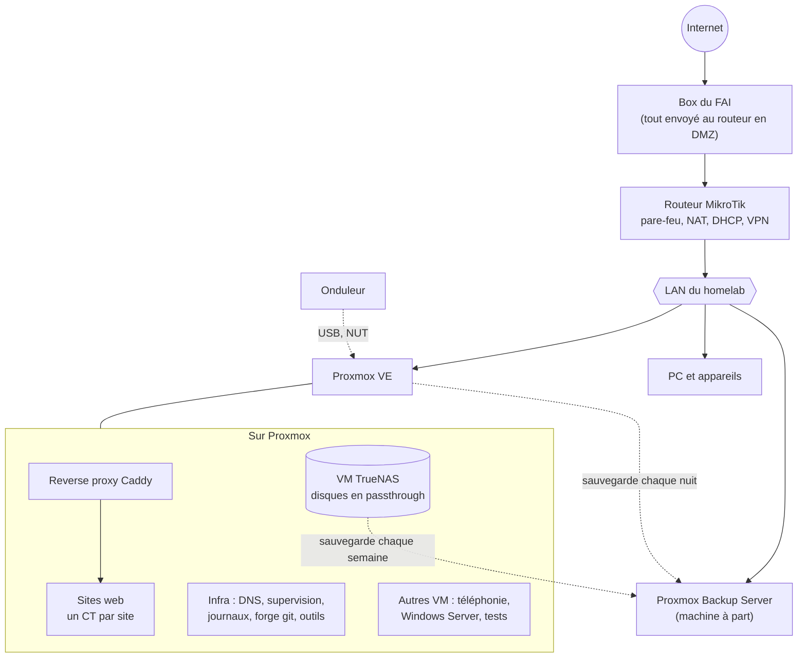

# Vue d'ensemble

## Le matériel

| Machine | Rôle | Détails |
| :-- | :-- | :-- |
| Station de travail d'occasion | Hyperviseur Proxmox VE | Xeon 6 cœurs, 128 Go de RAM, deux NVMe (système et disques des VM), trois disques de 8 To donnés à la VM TrueNAS |
| Deuxième machine | Proxmox Backup Server | Datastore ZFS d'environ 14 To |
| Routeur MikroTik | Passerelle du lab | Pare-feu, NAT, DHCP, VPN, DNS de secours |
| Onduleur | Protection électrique | Branché en USB sur l'hyperviseur, géré avec NUT |

Il n'y a qu'un seul hyperviseur. J'avais un deuxième nœud plus petit, je l'ai
retiré quand j'ai migré tout le lab sur la machine actuelle : pour un lab perso, un
gros nœud bien sauvegardé est plus simple qu'un cluster à deux nœuds sans quorum
propre.

## Les choix de base

- **LXC d'abord.** Un service, un conteneur. Je ne prends une VM que s'il faut un
  autre noyau ou un autre système : le NAS, la téléphonie, Windows Server, macOS.
- **Conteneurs non privilégiés** par défaut. J'ai refait sur un modèle commun les
  anciens conteneurs privilégiés les plus exposés.
- **Un modèle de CT commun.** Chaque nouveau conteneur passe par le même script de
  préparation (mises à jour de sécurité automatiques, DNS, journaux, pare-feu), voir
  [proxmox-scripts](https://github.com/tom-lion38/proxmox-scripts).
- **Rien d'administratif sur internet.** Proxmox, PBS, le NAS et mes outils ne
  répondent que depuis le LAN ou le VPN.
- **Tout est noté.** Plan d'adressage, noms, sauvegardes : si ce n'est pas écrit,
  ça n'existe pas.
